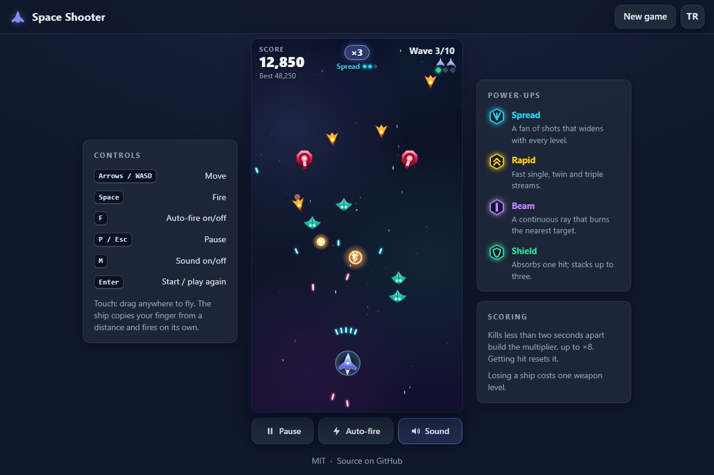

# Space Shooter - an original vertical arcade shooter for the browser

[](#tests)
[](LICENSE)

**▶ Play now: https://celaldrg.github.io/space-shooter/**



Fly a small fighter through ten scripted waves of weaving, diving and gun-turret enemies, collect weapon upgrades and shields, keep a combo going for up to ×8 points and finish the run against a three-phase boss. Ships, enemies, explosions and sounds are all made in code: there are no image or audio files.

## Features

- Ten hand-scripted waves: weavers, divers, aiming turrets and rocks that split into shards, then a boss that changes its attack in three phases.
- A basic blaster plus three weapons that level up (spread, rapid, beam), and shield charges that stack up to three. Losing a ship costs one weapon level.
- Combo multiplier: kills less than two seconds apart raise it step by step up to ×8; getting hit resets it.
- Original canvas art drawn with paths, a three-layer parallax starfield, particle explosions and screen shake.
- Sound effects synthesised live with the Web Audio API, with a mute switch.
- Keyboard and touch controls, an auto-fire switch, and an automatic pause when the tab is hidden.
- English and Turkish interface. Language, sound, auto-fire and your best score are remembered in the browser.
- Respects `prefers-reduced-motion`: no screen shake and calmer animations.
- A deterministic 60 Hz fixed-step simulation with a seeded random generator, written as plain ES modules with no dependencies and no build step.

## How to play

**Keyboard**

| Key | Action |
| --- | --- |
| Arrow keys / WASD | Move |
| Space (hold) | Fire |
| F | Auto-fire on/off |
| P / Esc | Pause / resume |
| M | Sound on/off |
| Enter | Start / play again |

**Touch**: put a finger anywhere on the play area and drag. The ship copies your finger's movement from wherever it is, so your finger never covers it, and it fires for as long as you touch the screen. The buttons under the play area pause the game and switch auto-fire and sound.

## Run locally

The game is a set of static files that use ES modules, and browsers only load modules over `http://`, not from `file://`. Serve the folder with any static server, for example:

```sh
npx serve .
```

Then open the address it prints. Adding `?demo` to the address shows the frozen mid-game scene used for the screenshot; a key press or a tap on the play area sets it in motion, and it never saves a best score.

## Tests

```sh
node --test
```

Needs Node 22 or newer and nothing else. The suites cover:

- the game logic: the seeded generator, object pools, swept collisions (no bullet tunnelling), enemy behaviour, wave scripts, boss phases, weapons and pickups, scoring and the combo, lives and game over, determinism across frame rates, and the `?demo` state;
- the browser helpers: guarded storage, settings, key mapping, canvas scaling and pointer mapping, the starfield, and the sound engine (against a stand-in audio context);
- the page: English and Turkish strings with matching keys and placeholders, every visible text and label translated, metadata and files present, modules that load without a browser, and no unsafe calls.

## Project structure

```text
index.html, style.css       page, HUD, overlays and theme
src/
  main.js                   entry point: wires everything up and runs the frame loop
  game.js, player.js, weapons.js, enemies.js, waves.js, director.js, boss.js, ...
                            pure game logic (no DOM)
  render.js, art.js, starfield.js, viewport.js
                            canvas drawing
  hud.js, input.js, keys.js, audio.js
                            HUD, keyboard and touch, sound
  i18n.js, settings.js, storage.js
                            strings, preferences, guarded localStorage
test/                       node:test suites
docs/screenshot.png         README image
```

## License

MIT, see [LICENSE](LICENSE).

## Türkçe

**▶ Hemen oyna: https://celaldrg.github.io/space-shooter/**

Küçük bir savaş gemisiyle on senaryolu dalga boyunca kıvrılarak gelen, dalış yapan ve nişan alan taret düşmanlarla savaş; silah yükseltmeleri ve kalkan topla, çarpanı ×8'e kadar canlı tut ve oyunu üç aşamalı bir ana gemiye karşı bitir. Gemiler, düşmanlar, patlamalar ve sesler kodla üretilir; hiçbir resim ya da ses dosyası yoktur.

### Özellikler

- Elle yazılmış on dalga: kıvrılan, dalan ve nişan alan düşmanlar, parçalara bölünen kayalar; ardından saldırısını üç aşamada değiştiren bir ana gemi.
- Temel lazerin yanında seviye atlayan üç silah (yelpaze, seri, ışın) ve üç taneye kadar biriken kalkan. Gemi kaybedince silah bir seviye düşer.
- Çarpan: iki saniyeden kısa arayla yapılan imhalar çarpanı adım adım ×8'e kadar yükseltir; vurulunca sıfırlanır.
- Canvas yollarıyla çizilmiş özgün gemiler, üç katmanlı paralaks yıldız alanı, parçacık patlamaları ve ekran sarsıntısı.
- Web Audio API ile anlık sentezlenen ses efektleri ve ses kapatma düğmesi.
- Klavye ve dokunmatik kontrol, otomatik ateş düğmesi; sekme gizlenince oyun kendiliğinden duraklar.
- İngilizce ve Türkçe arayüz. Dil, ses, otomatik ateş ve en iyi skor tarayıcıda saklanır.
- `prefers-reduced-motion` ayarına uyar: ekran sarsıntısı yok, animasyonlar daha sakin.
- Tohumlu rastgele sayı üreteciyle deterministik, 60 Hz sabit adımlı simülasyon; bağımlılıksız ve derleme adımsız düz ES modülleri.

### Nasıl oynanır

**Klavye**

| Tuş | İşlev |
| --- | --- |
| Ok tuşları / WASD | Hareket |
| Boşluk (basılı tut) | Ateş |
| F | Otomatik ateş aç/kapat |
| P / Esc | Duraklat / sürdür |
| M | Ses aç/kapat |
| Enter | Başla / tekrar oyna |

**Dokunmatik**: oyun alanının herhangi bir yerine parmağını koy ve sürükle. Gemi, parmağının hareketini bulunduğu yerden kopyalar, böylece parmağın gemiyi hiç kapatmaz; ekrana dokunduğun sürece ateş eder. Oyun alanının altındaki düğmeler oyunu duraklatır, otomatik ateşi ve sesi açıp kapatır.

### Yerelde çalıştırma

Oyun ES modülleri kullanan statik dosyalardan oluşur; tarayıcılar modülleri yalnızca `http://` üzerinden yükler, `file://` ile açılmaz. Klasörü herhangi bir statik sunucuyla sun, örneğin:

```sh
npx serve .
```

Sonra yazdırdığı adresi aç. Adrese `?demo` eklemek ekran görüntüsündeki donmuş oyun anını gösterir; bir tuşa basmak ya da oyun alanına dokunmak onu hareketlendirir ve en iyi skor kaydedilmez.

### Testler

```sh
node --test
```

Node 22 veya üstü yeterli, başka bir şey gerekmez. Testler oyun mantığını (tohumlu üreteç, nesne havuzları, mermi kaçırmayan çarpışma, düşman davranışı, dalgalar, ana gemi aşamaları, silahlar, skor ve çarpan, determinizm, `?demo` durumu), tarayıcı yardımcılarını (güvenli depolama, ayarlar, tuşlar, canvas ölçekleme, yıldız alanı, sahte bir ses bağlamıyla ses motoru) ve sayfayı (İngilizce ve Türkçe metinler, çevrilmemiş metin kalmaması, meta etiketler, dosyalar, tarayıcısız yüklenen modüller) kapsar.

### Lisans

MIT, bkz. [LICENSE](LICENSE).
